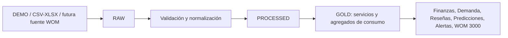

# Entrega 3 · Modelo de datos y capa Gold

## Arquitectura real

El flujo representa la arquitectura implementada y preparada. DEMO y la base relacional sí están operativos. RAW/PROCESSED/GOLD están materializados con más claridad en el pipeline de reseñas; en el resto, Gold se expone mediante servicios y agregaciones SQL. No se afirma un lago de datos físico completo.

## Modelo relacional actual

| Entidad | PK y granularidad | Relaciones verificables |
|---|---|---|
| `dim_location` | `id`, un local | 1:N con `dim_room`, gastos, reseñas y tarifas |
| `dim_room` | `id`, una sala | FK `location_id`; 1:N sesiones y horarios |
| `dim_game_master` | `id`, un GM | FK desde sesión; vigencia de actividad |
| `fact_session` | `id`, una sesión | FK sala y uno/dos GMs |
| `fact_expense` | `id`, un cargo | FK categoría, local y sala opcionales |
| `recurring_expense_plan` | `id`, regla vigente | materializa cargos recurrentes |
| `fact_review` | `id`, reseña | FK local/sala opcionales |
| `raw_review` | `id`, reseña original RAW | hash, fuente, local Google y payload |
| `processed_review` | FK `raw_review_id` | resultado NLP uno a uno |
| `review_gold_snapshot` | `scope_key` | agregado Gold por ámbito y versión |
| `dim_game_master_rate` | `id`, tarifa/vigencia | FK local y sala opcional |
| `room_schedule` | `id`, slot ofertable | FK sala y temporada |
| `insight_alert` | `id`, evento auditable | clave estable, evidencia y estado |
| `data_import_run` | `id`, ejecución | datasets, resultado y estado |

PK identifica el registro; FK conecta dimensiones y hechos. La sesión es la granularidad operativa de reservas, ingresos y atribución. El gasto puede ser común al local, directo a una sala o sin asignación.

## RAW, PROCESSED y GOLD

RAW conserva para reseñas el payload original, hash, identificadores externos, origen, tiempos de creación/actualización y última observación. La sincronización incremental clasifica nuevos, modificados, sin cambios y fallidos.

PROCESSED normaliza texto, detecta idioma, calcula sentimiento y confianza heurística, extrae aspectos y entidades, identifica sala solo con evidencia textual y registra versión del analizador. Las reseñas sin texto no generan sentimiento ni aspectos.

GOLD se expresa mediante `ReviewGoldSnapshot` y servicios de resumen: denominadores, distribución de sentimiento, aspectos, evidencias, fortalezas, problemas y comparación por local. En Finanzas, Demanda, Predicciones y Alertas son agregados calculados por servicios sobre hechos y dimensiones; no se importan KPI precalculados.

## Gestión, idempotencia y calidad

Gestión de Datos selecciona fuente y datasets, ejecuta la importación DEMO, cuenta registros, registra la ejecución y reevalúa alertas si corresponde. Repetirla no recrea registros: devuelve sin cambios.

La API conserva `source_system`, `external_id`, fechas de actualización e importación. Los conectores de archivo validan encoding, delimitador, fechas y decimales; la importación real exige mapping confirmado.

La consistencia local-sala se comprueba en filtros y relaciones; una sala seleccionada con otro local es rechazada. Los valores imposibles deben bloquearse mediante validaciones de esquema. La sustitución futura por PostgreSQL está prevista mediante `WOM_DATABASE_URL`, pero no existe migración Alembic versionada.

## Integración futura

La fuente WOM en Railway requiere inspección técnica antes de implementar un conector: mecanismo de acceso, autenticación, tablas, estados, relaciones, identificadores, permisos y frecuencia. Hasta entonces, la aplicación marca la fuente como pendiente y mantiene DEMO aislado.
